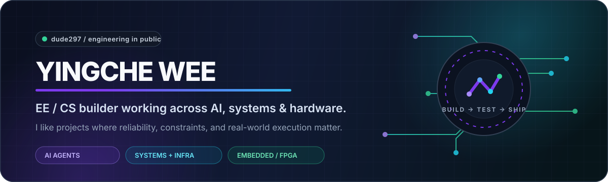
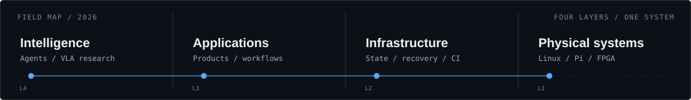

  

  <a href="https://weeche.com/"><b>Portfolio</b></a>
  &nbsp;·&nbsp;
  <a href="https://weeche.com/resume.html"><b>Résumé</b></a>
  &nbsp;·&nbsp;
  <a href="https://github.com/dude297?tab=repositories"><b>Projects</b></a>
  &nbsp;·&nbsp;
  <a href="https://www.linkedin.com/in/yingche-wee"><b>Connect</b></a>

  <b>I co-found housing software, build circuit-diagnosis tools, and connect Linux systems.</b> 
  AI agents · distributed systems · local infrastructure · embedded Linux · electronics

 

## Selected builds

### ScholarSafe · Co-founder & Engineering Lead
Build the student-housing and roommate-matching workflows: authentication, weighted matching, messaging, verification, moderation, and database access policies. Product checks include 400+ passing automated tests.

[Case study](https://weeche.com/projects/scholarsafe.html) · [Product](https://scholarsafe-io2.vercel.app)

### Ohmni · Circuit diagnostics
Built a schematic-to-diagnosis prototype at the BuilderBase SF Tech Week hackathon. Vision models propose a graph; human confirmation gates a TypeScript circuit solver. Measured voltages rank candidate faults and guide the next probe. Development continues after submission.

[Case study](https://weeche.com/projects/ohmni.html) · [Source](https://github.com/dude297/ohmni) · [Try the lab](https://multimodal-hackathon-sage.vercel.app)

### Converge · Supabase Select hackathon
Persist the intended outcome, check Stripe and Supabase, and repair only the missing work. Demonstrated recovery after a simulated interruption without repeating a completed Stripe test-mode refund.

[Case study](https://weeche.com/projects/converge.html) · [Demo](https://scholarsafe.vercel.app)

### HomeHub · Distributed Linux & local AI
Connect a Raspberry Pi edge node and HP Envy compute node over Matrix and Tailscale. SQLite state, sandboxed tools, watchdogs, systemd services, and 300+ automated tests.

[Case study](https://weeche.com/projects/homehub.html)

### ColleAgent / CampusMesh · Hackathon at Stanford
Keep student records with a private planner while public research agents receive only the fields needed to look up course requirements. Includes evidence checks, alternative plans, and counselor review; continuing as a prototype.

[Case study](https://weeche.com/projects/colleagent.html)

### After the Shield · VLA safety research
Studying whether a safety intervention changes a robot policy’s next proposed action. Currently setting up the simulator and models; no paired experimental results yet.

[Case study](https://weeche.com/projects/after-the-shield.html)

## Tools I build with

Tools used in the projects above:

| Layer | Working toolkit | Example |
| :-- | :-- | :-- |
| **Languages** | Python · TypeScript / JavaScript · SQL; Java and C++ through coursework | [HomeHub](https://weeche.com/projects/homehub.html) · [ColleAgent](https://weeche.com/projects/colleagent.html) |
| **Product + data** | Next.js · React · FastAPI · Supabase / PostgreSQL · SQLite | [Converge](https://weeche.com/projects/converge.html) · [ScholarSafe](https://weeche.com/projects/scholarsafe.html) |
| **Systems + testing** | Linux · Docker · systemd · GitHub Actions · Tailscale · Playwright | [Plasma Dynamic Wallpaper](https://github.com/dude297/plasma-dynamic-wallpaper) · [HomeHub](https://weeche.com/projects/homehub.html) |
| **Agents + hardware** | Agent tool use · model evaluation · Jupyter · Raspberry Pi · electronics; FPGA / Verilog in exploration | [ColleAgent](https://weeche.com/projects/colleagent.html) · [VLA research](https://weeche.com/projects/after-the-shield.html) |

## Public builds you can inspect

Public source and releases:

| Release | What works | Explore |
| :-- | :-- | :-- |
| **[Plasma Dynamic Wallpaper](https://github.com/dude297/plasma-dynamic-wallpaper)** | Brings Apple Dynamic Desktop schedules and solar-time alignment to KDE Plasma; published on PyPI. | [Source](https://github.com/dude297/plasma-dynamic-wallpaper) · [PyPI](https://pypi.org/project/plasma-dynamic-wallpaper/) |
| **[Internship Finder](https://github.com/dude297/internship-finder)** | Tracks verified opportunities, eligibility, scoring, and application state. | [Source](https://github.com/dude297/internship-finder) · [Demo](https://internship-finder-pi.vercel.app) |

 Plasma Dynamic Wallpaper running on KDE Plasma.

## How I build

<table>
<tr>
<td align="center" width="25%"><b>01</b> Model the constraint</td>
<td align="center" width="25%"><b>02</b> Build the smallest real system</td>
<td align="center" width="25%"><b>03</b> Attack the failure modes</td>
<td align="center" width="25%"><b>04</b> Ship + observe</td>
</tr>
</table>

 

**AI training:** Harvard Computer Society AI Bootcamp, remote, Winter 2024. Built CNNs, sentiment classifiers, and reinforcement-learning models.

**Beyond code:** I co-founded and help lead engineering for ScholarSafe, founded an AI Club with 12+ peer workshops, and collaborate on educational AI evaluation with San José State University. <a href="https://weeche.com/resume.html">More in my résumé →</a>

 

  <b>software ↔ systems ↔ hardware</b> · <a href="https://www.linkedin.com/in/yingche-wee">LinkedIn</a>

